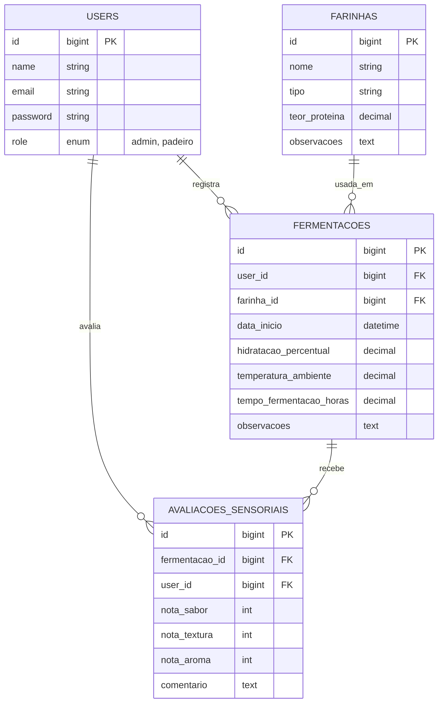

# Artefatos de Engenharia de Software — PaoLab Admin

## Modelagem do banco de dados (DER)

## Requisitos (MoSCoW)

| Requisito                                           | Prioridade                           |
| --------------------------------------------------- | ------------------------------------ |
| Autenticação de usuário (login)                     | Must                                 |
| CRUD de farinhas                                    | Must                                 |
| Listagem de fermentações                            | Must                                 |
| Listagem de avaliações sensoriais                   | Must                                 |
| Validação de formulários (cadastro de farinha)      | Must                                 |
| Policy: padeiro só edita seus próprios registros    | Should                               |
| Gestão de usuários (padeiros) pelo admin            | Should                               |
| Filtro/busca de fermentações por padeiro ou período | Could                                |
| Dashboard com gráficos de avaliações                | Could                                |
| Exportação de relatórios (PDF/CSV)                  | Won't (fora do escopo desta entrega) |

## Protótipos de tela

Reaproveitados do domínio do app mobile (referência conceitual): [Figma — PaoLab Mobile](https://www.figma.com/design/cpvoitQcVrBi2hYD4pNeCO/pao-lab-moblie). As telas do painel web serão adaptadas desse mesmo domínio, mas desenhadas para o formato Blade/web (a definir com mais detalhe ao longo da implementação).

## Planejamento de sprints

- **Sprint 1** (Checkpoint Inicial): estrutura do projeto Laravel, Migrations, Models, artefatos de planejamento (este documento), Readme, repositório no GitHub.
- **Sprint 2**: autenticação, CRUD de farinhas, validação de formulários.
- **Sprint 3**: listagem de fermentações e avaliações sensoriais, Policies.
- **Sprint 4** (Checkpoint Final): ajustes finais, testes, vídeo de defesa do código.
